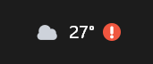
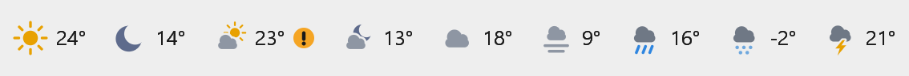
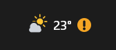
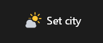
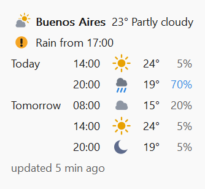

# Taskbar Glance

[](https://github.com/lucaslobasso/taskbar-glance/actions/workflows/ci.yml)
[](https://github.com/lucaslobasso/taskbar-glance/releases)
[](LICENSE)
[](#requirements)
[](#light-by-design)

<p align="center">
  
  <br>
  
</p>

The weather in the Windows 11 taskbar: the temperature, an icon for the sky, and a mark when rain or a thunderstorm is announced for later today. Hover for the rest of today and tomorrow, click for the full forecast. It is one tiny native exe and makes one small request every 30 minutes.

**[Requirements](#requirements) · [Install](#install) · [Settings](#settings) · [How it looks](#how-it-looks) · [Update](#update) · [How it works](#how-it-works) · [Troubleshooting](#troubleshooting) · [Uninstall](#uninstall)**

## What you get

- **The strip:** a sky icon (sun, moon, partly cloudy, cloud, fog, rain, snow, thunder; day or night) and the temperature, in °C or °F.
- **The warning mark:** an amber `!` when rain is announced for later today, a red one for a thunderstorm. It is not shown while it already rains, or snows.
- **Hover:** the current weather, what is coming, and the forecast at 08:00, 14:00 and 20:00 (you choose the hours) for the rest of today and tomorrow, with the chance of rain.
- **Click:** opens the forecast page you prefer (`weatherUrl`), or a web search for your city's weather. **Right-click** for refresh, °C / °F, left or right side, start with Windows.
- **Next to [Claude Taskbar](https://github.com/lucaslobasso/claude-taskbar):** Glance keeps the anchored edge and Claude Taskbar (1.2 and newer) docks just outside it, so they never overlap.

### Light by design

- **Tiny.** A ~1.6 MB native exe (.NET Native AOT, raw Win32, no UI framework): about 3.6 MB private memory, under 1 MB working set when idle.
- **Idle means idle.** It sleeps until a timer, the mouse or a settings change wakes it. There is no polling loop, and one request is made every 30 minutes.
- **Gets out of the way.** It hides while a full-screen app is in front.
- **No account, no API key.** Weather data comes from [Open-Meteo](https://open-meteo.com). The only things that leave your PC are the city name (once, to find its coordinates) and those coordinates.

## Requirements

- Windows 11 (Windows 10 works, but the strip is designed for the Windows 11 taskbar).
- Nothing else for the one-line install: the release is a self-contained native exe.

## Install

**One line** (PowerShell, no SDK or git needed):

```powershell
irm https://raw.githubusercontent.com/lucaslobasso/taskbar-glance/main/bootstrap.ps1 | iex
```

It downloads `TaskbarGlance.exe` from the latest release, checks its SHA-256, installs it to `%LOCALAPPDATA%\TaskbarGlance` and starts it with Windows. Read [`bootstrap.ps1`](bootstrap.ps1) first if you like; it's short. With your city, or without autostart:

```powershell
& ([scriptblock]::Create((irm https://raw.githubusercontent.com/lucaslobasso/taskbar-glance/main/bootstrap.ps1))) -City "Buenos Aires" -NoAutostart
```

Without `-City` the strip says "Set city": click it, fill in `"city"` in the file that opens (Notepad) and save.

**From source** (contributors): needs the [.NET 11 SDK](https://dotnet.microsoft.com/download) and the Visual Studio **Desktop development with C++** workload (Native AOT uses the MSVC linker; Build Tools are enough).

```powershell
git clone https://github.com/lucaslobasso/taskbar-glance
cd taskbar-glance
.\install.ps1 -City "Buenos Aires"     # builds, installs, starts with Windows; -NoAutostart
```

## Settings

Right-click the strip for the common ones, or edit `%LOCALAPPDATA%\TaskbarGlance\glance.json` (changes apply on save):

| Key | Default | |
|---|---|---|
| `city` | `""` | your city. Add a region or country to pick between namesakes: `"La Plata, Argentina"` |
| `units` | `"C"` | `"C"` or `"F"` |
| `weatherUrl` | `""` | page opened on click (`http` or `https` only). Empty = a web search for "weather" and the city |
| `forecastHours` | `[8, 14, 20]` | hours shown in the popup |
| `rainWarnPercent` | `50` | chance of rain that counts as "rain later today" |
| `refreshMinutes` | `30` | time between requests (10 to 720) |
| `position` | `"right"` | `"right"` = next to the tray, `"left"` = the taskbar's left edge (handy with centered icons) |
| `offsetX` | `0` | extra gap in pixels (at 100% scaling) from the chosen edge, e.g. to clear the Widgets button on the left |
| `showWeather` | `true` | show the weather segment |

The app adds a `location` block with the coordinates it found for the city. Edit its `latitude` and `longitude` for an exact spot.

## How it looks

<sub>Pictures drawn by the app's own rendering code (`TaskbarGlance.exe --render`, see [Contributing](#contributing)) at 150% scaling, on the Windows 11 taskbar colors, for made-up forecasts.</sub>

| Setting | Picture |
| --- | --- |
| Every icon, day and night: clear, moon, partly cloudy with rain later, night with clouds, cloud, fog, rain, snow with a warning, thunder |  |
| The same on a light taskbar (follows the Windows theme) |  |
| Rain announced for later today: amber mark |  |
| A thunderstorm announced for later today: red mark |  |
| `units: "F"` |  |
| No city yet |  |
| Hover, rain later today |  |
| Hover, light taskbar |  |

## Update

Run the one-line install again; it replaces the exe and keeps your settings. From a clone: `git pull`, then `.\install.ps1`. See [CHANGELOG.md](CHANGELOG.md).

## How it works

- The strip is a per-pixel-alpha layered window owned by the taskbar, so it stays drawn above it. It follows the tray's size, DPI and light/dark changes, re-docks if Explorer restarts and hides while a full-screen app is in front.
- The icons are drawn from shapes in code: no image files, and they stay sharp at any scaling.
- One request to Open-Meteo brings the current reading and two days of hourly forecast. It is saved to `weather.json`, so a restart shows it at once. Everything is kept in °C and in the city's own time; °F is only a display conversion, so switching units needs no request.
- Offline, it retries after 1, 5 and then every 15 minutes. After 90 minutes the reading is considered old and the forecast for the current hour is shown instead; if that is not available either, the strip shows `–` (a wrong number is worse than none).
- After sleep it refreshes by itself once the network is back.
- Requests use WinHTTP, so Windows' own TLS and proxy settings apply.

## Troubleshooting

- **The strip says "Set city".** Click it, fill in `"city"` in `glance.json` and save.
- **"City not found".** Try `"Name, Country"`, or put the `latitude` and `longitude` of the place in the `location` block yourself.
- **It shows `–`.** There is no recent data: no connection yet, or the weather service can't be reached. The popup says which. It tries again by itself; **Refresh now** in the right-click menu forces it. See `%LOCALAPPDATA%\TaskbarGlance\glance.log` (set `GLANCE_DEBUG=1` for more detail).
- **The temperature is a few degrees off.** Open-Meteo gives the model value for your coordinates. Edit `latitude` and `longitude` in `glance.json` for a closer spot.
- **Windows SmartScreen warns about the exe.** It isn't code-signed. The one-line install checks the release's SHA-256 and unblocks the file; you can also build it yourself from source.
- **It overlaps another strip on the same side.** Use `offsetX`, or `position` on one of them. [Claude Taskbar](https://github.com/lucaslobasso/claude-taskbar) 1.2 and newer steps aside by itself.
- **With `position: "left"`, it overlaps the Widgets button.** Raise `offsetX`, or turn Widgets off (Settings → Personalization → Taskbar).

## Uninstall

```powershell
& ([scriptblock]::Create((irm https://raw.githubusercontent.com/lucaslobasso/taskbar-glance/main/bootstrap.ps1))) -Uninstall          # add -Purge to also delete settings, saved forecast and log
```

From a clone: `.\uninstall.ps1` (or `.\uninstall.ps1 -Purge`).

## Contributing

```powershell
dotnet publish src/TaskbarGlance.csproj -c Release -o out   # Native AOT build
python tests/check.py                                       # what the strip and popup say for made-up forecasts
python docs/render.py                                       # redraw the README pictures (pip install pillow)
```

- Test with a separate folder, never your real settings: `GLANCE_DIR=<folder>` moves settings, saved forecast and log, and such a copy runs next to the installed one. `GLANCE_OFFLINE=1` never fetches. See [CLAUDE.md](CLAUDE.md).
- `TaskbarGlance.exe --render strip|tip|text out data=forecast.json now=2026-11-16T15:10 [light] [unit=F] ...` draws or describes the strip and popup for made-up data without opening a window; `docs/render.py` turns that into the PNGs above.
- A tag `v*` builds the exe in CI and publishes a GitHub release with its SHA-256, which the one-line install picks up.
- Planned: the next Google Calendar event as a second segment.

## License

[MIT](LICENSE) © Lucas Lobasso. Weather data by [Open-Meteo](https://open-meteo.com) ([CC BY 4.0](https://creativecommons.org/licenses/by/4.0/)).
