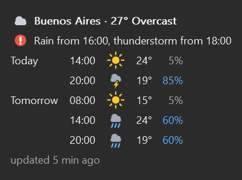
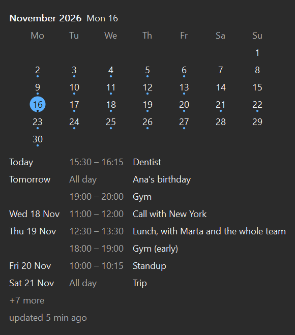
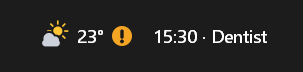
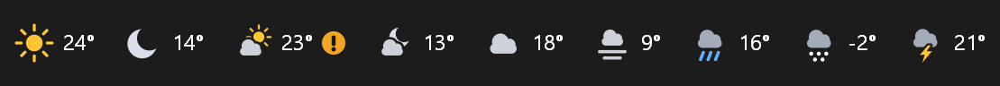
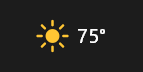
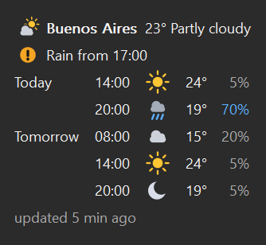
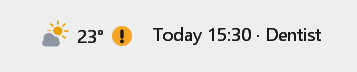
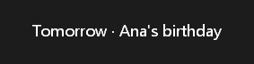
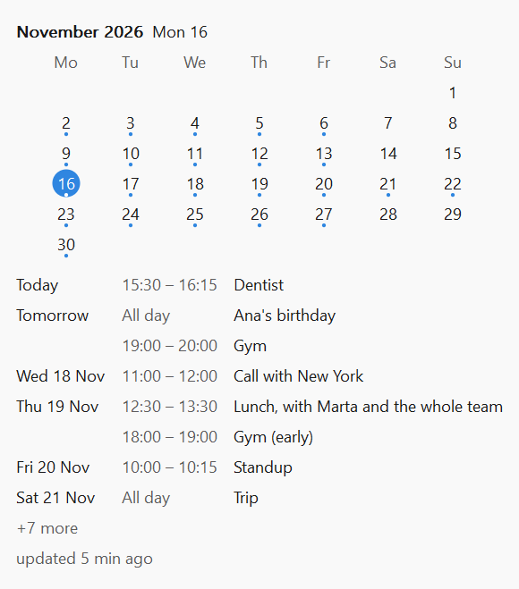

# Taskbar Glance

[](https://github.com/lucaslobasso/taskbar-glance/actions/workflows/ci.yml)
[](https://github.com/lucaslobasso/taskbar-glance/releases)
[](LICENSE)
[](#requirements)
[](#light-by-design)

<p align="center">
  
  
  <br>
  
</p>

The weather and your next calendar event in the Windows 11 taskbar: the temperature, an icon for the sky, a mark when rain or a thunderstorm is announced for later today, and what is next on your calendar. Hover for the forecast or for the month and the coming events, click for the full page. It is one tiny native exe that sleeps between a small request every 30 minutes for the weather and one every 15 for each calendar.

**[Requirements](#requirements) · [Install](#install) · [Calendar](#calendar) · [Settings](#settings) · [How it looks](#how-it-looks) · [Update](#update) · [How it works](#how-it-works) · [Troubleshooting](#troubleshooting) · [Uninstall](#uninstall)**

## What you get

- **The strip:** a sky icon (sun, moon, partly cloudy, cloud, fog, rain, snow, thunder; day or night) and the temperature, in °C or °F.
- **The warning mark:** an amber `!` when rain is announced for later today, a red one for a thunderstorm. It is not shown while it already rains, or snows.
- **Hover:** the current weather, what is coming, and the forecast at 08:00, 14:00 and 20:00 (you choose the hours) for the rest of today and tomorrow, with the chance of rain.
- **Click:** opens the forecast page you prefer (`weatherUrl`), or a web search for your city's weather. **Right-click** for refresh, °C / °F, left or right side, start with Windows, check for updates.
- **The next event** (once you [add a calendar](#calendar)): `15:30 · Dentist`, `Tomorrow · Ana's birthday`, `Thu 10:00 · Standup`, or `Now · Standup` while it is going on. Hover for this month, with today and the days that have events marked, and the events of the next 14 days. Click opens Google Calendar.
- **Next to [Claude Taskbar](https://github.com/lucaslobasso/claude-taskbar):** Glance keeps the anchored edge and Claude Taskbar (1.2 and newer) docks just outside it, so they never overlap.

### Light by design

- **Tiny.** A ~1.9 MB native exe (.NET Native AOT, raw Win32, no UI framework): about 5 MB private memory, under 1 MB working set when idle.
- **Idle means idle.** It sleeps until a timer, the mouse or a settings change wakes it. There is no polling loop: one request every 30 minutes for the weather, one every 15 for each calendar, and one timer set for the moment the next event starts.
- **Gets out of the way.** It hides while a full-screen app is in front.
- **No account, no API key.** Weather data comes from [Open-Meteo](https://open-meteo.com). The only things that leave your PC are the city name (once, to find its coordinates) and those coordinates. The calendar is read straight from the address you give it; nothing about it goes anywhere else. GitHub is asked for a newer version only when you click **Check for updates**.

## Requirements

- Windows 11 (Windows 10 works, but the strip is designed for the Windows 11 taskbar).
- Nothing else for the one-line install: the release is a self-contained native exe.

## Install

**One line** (PowerShell, no SDK or git needed):

```powershell
irm https://raw.githubusercontent.com/lucaslobasso/taskbar-glance/main/bootstrap.ps1 | iex
```

It downloads `TaskbarGlance.exe` from the latest release, checks its SHA-256, installs it to `%LOCALAPPDATA%\TaskbarGlance` and starts it with Windows. Read [`bootstrap.ps1`](bootstrap.ps1) first if you like; it's short. With your city, or without autostart:

```powershell
& ([scriptblock]::Create((irm https://raw.githubusercontent.com/lucaslobasso/taskbar-glance/main/bootstrap.ps1))) -City "Buenos Aires" -NoAutostart
```

Without `-City` the strip says "Set city": click it, fill in `"city"` in the file that opens (Notepad) and save.

**From source** (contributors): needs the [.NET 11 SDK](https://dotnet.microsoft.com/download) and the Visual Studio **Desktop development with C++** workload (Native AOT uses the MSVC linker; Build Tools are enough).

```powershell
git clone https://github.com/lucaslobasso/taskbar-glance
cd taskbar-glance
.\install.ps1 -City "Buenos Aires"     # builds, installs, starts with Windows; -NoAutostart
```

## Calendar

The calendar segment appears once the settings have the address of a calendar in iCal format. For Google Calendar that is its *secret address*: no sign-in, no permissions to grant.

1. Open [Google Calendar](https://calendar.google.com) in a browser, then the gear → **Settings**.
2. On the left, under **Settings for my calendars**, click the calendar.
3. Scroll to **Integrate calendar** and copy **Secret address in iCal format** (it ends in `basic.ics`).
4. Right-click the strip → **Open settings file** and paste it between the brackets of `"calendars"`, in quotes. For more calendars, separate them with commas:

```json
"calendars": [
  "https://calendar.google.com/calendar/ical/you%40gmail.com/private-0123456789abcdef/basic.ics",
  "https://calendar.google.com/calendar/ical/family.../private-.../basic.ics"
],
```

Save, and the next event shows up within seconds.

- **Treat the address like a password:** whoever has it can read that calendar. It stays in `glance.json` on your PC; the log and the saved copy never contain it. If it leaks, Google's **Reset** button next to it makes a new one.
- **Any iCal address works**, not just Google's: Outlook.com (*Settings → Calendar → Shared calendars → Publish a calendar → ICS*), iCloud public calendars, a holiday or sports calendar. `webcal://` addresses are fine as they are.
- **What the strip shows:** the next event still to start today; else the one going on now; else today's all-day event; else the first event of the coming days (`calendarDays`). An event of two calendars shows once.
- **When:** an event of today shows just its time (`15:30 · Dentist`). Otherwise a legend says the day: `Tomorrow`, the weekday while it is still this week (`Thu 10:00 · Standup`), the date after that (`Nov 26 · Thanksgiving Day`).
- **Repeating events** are worked out on your PC: daily, weekly, monthly and yearly rules ("every other Tuesday", "the last Friday of the month", "until June", "10 times"), skipped and moved occurrences, cancelled events, and time zones with their summer time. Events that repeat every few hours or minutes count once.
- Times use the 24-hour clock and your PC's time zone. The month starts on the day Windows is set to (*Settings → Time & language → Language & region → Regional format*).

## Settings

Right-click the strip for the common ones, or edit `%LOCALAPPDATA%\TaskbarGlance\glance.json` (changes apply on save):

| Key | Default | |
|---|---|---|
| `city` | `""` | your city. Add a region or country to pick between namesakes: `"La Plata, Argentina"` |
| `units` | `"C"` | `"C"` or `"F"` |
| `weatherUrl` | `""` | page opened on click (`http` or `https` only). Empty = a web search for "weather" and the city |
| `forecastHours` | `[8, 14, 20]` | hours shown in the popup |
| `rainWarnPercent` | `50` | chance of rain that counts as "rain later today" |
| `refreshMinutes` | `30` | time between requests (10 to 720) |
| `position` | `"right"` | `"right"` = next to the tray, `"left"` = the taskbar's left edge (handy with centered icons) |
| `offsetX` | `0` | extra gap in pixels (at 100% scaling) from the chosen edge, e.g. to clear the Widgets button on the left |
| `showWeather` | `true` | show the weather segment |
| `showCalendar` | `true` | show the calendar segment (it only appears once `calendars` has an address) |
| `calendars` | `[]` | iCal addresses, see [Calendar](#calendar) |
| `calendarUrl` | `""` | page opened on click (`http` or `https` only). Empty = Google Calendar |
| `calendarDays` | `14` | how many days ahead the strip and the popup look (1 to 60) |
| `calendarRows` | `8` | events listed in the popup (1 to 30); the rest is counted as "+3 more" |
| `calendarTitleLength` | `24` | longer titles are cut on the strip (4 to 80) |
| `calendarRefreshMinutes` | `15` | time between downloads of each calendar (5 to 720) |

The app adds a `location` block with the coordinates it found for the city. Edit its `latitude` and `longitude` for an exact spot.

## How it looks

<sub>Pictures drawn by the app's own rendering code (`TaskbarGlance.exe --render`, see [Contributing](#contributing)) at 150% scaling, on the Windows 11 taskbar colors, for made-up forecasts and a made-up calendar.</sub>

| Setting | Picture |
| --- | --- |
| Every icon, day and night: clear, moon, partly cloudy with rain later, night with clouds, cloud, fog, rain, snow with a warning, thunder |  |
| The same on a light taskbar (follows the Windows theme) |  |
| Rain announced for later today: amber mark |  |
| A thunderstorm announced for later today: red mark |  |
| `units: "F"` |  |
| No city yet |  |
| Hover, rain later today |  |
| Hover, light taskbar |  |
| With a calendar: the next event |  |
| The same on a light taskbar |  |
| `showWeather: false`, nothing left today |  |
| Hover on the calendar |  |
| The same, light taskbar |  |

## Update

Right-click the strip → **Check for updates**. If there is a newer release it asks, downloads it, checks it against the release's SHA-256, replaces the exe and restarts; your settings stay. It never checks on its own.

Versions before 1.2 have no such entry: run the one-line install again (it also replaces the exe and keeps your settings). From a clone: `git pull`, then `.\install.ps1`. See [CHANGELOG.md](CHANGELOG.md).

## How it works

- The strip is a per-pixel-alpha layered window owned by the taskbar, so it stays drawn above it. It follows the tray's size, DPI and light/dark changes, re-docks if Explorer restarts and hides while a full-screen app is in front.
- The icons are drawn from shapes in code: no image files, and they stay sharp at any scaling.
- One request to Open-Meteo brings the current reading and two days of hourly forecast. It is saved to `weather.json`, so a restart shows it at once. Everything is kept in °C and in the city's own time; °F is only a display conversion, so switching units needs no request.
- Offline, it retries after 1, 5 and then every 15 minutes. After 90 minutes the reading is considered old and the forecast for the current hour is shown instead; if that is not available either, the strip shows `–` (a wrong number is worse than none).
- Each calendar is downloaded as one iCal file and read by the app's own small reader: only the events from a month back to two months ahead are kept (title and time, nothing else), saved to `calendar.json` so a restart shows them at once. If a calendar can't be reached, the last copy stays and it retries after 1, 5 and then every 15 minutes.
- The calendar text changes without any polling: one timer is set for the next moment it has to (an event of today starts or ends, or midnight).
- After sleep it refreshes by itself once the network is back.
- Requests use WinHTTP, so Windows' own TLS and proxy settings apply.

## Troubleshooting

- **The strip says "Set city".** Click it, fill in `"city"` in `glance.json` and save.
- **"City not found".** Try `"Name, Country"`, or put the `latitude` and `longitude` of the place in the `location` block yourself.
- **It shows `–`.** There is no recent data: no connection yet, or the weather service can't be reached. The popup says which. It tries again by itself; **Refresh now** in the right-click menu forces it. See `%LOCALAPPDATA%\TaskbarGlance\glance.log` (set `GLANCE_DEBUG=1` for more detail).
- **The temperature is a few degrees off.** Open-Meteo gives the model value for your coordinates. Edit `latitude` and `longitude` in `glance.json` for a closer spot.
- **There is no calendar segment.** `calendars` is empty (see [Calendar](#calendar)) or `showCalendar` is `false`.
- **The calendar shows `–`, or the popup says it can't reach the calendar.** The address could not be downloaded or is not an iCal file: check that you copied the *secret address in iCal format* (ending in `.ics`), not the public or the embed one. `glance.log` says which calendar (by its position in the list) and why.
- **A new event takes a while to appear.** Calendars are downloaded every 15 minutes (`calendarRefreshMinutes`); **Refresh now** in the right-click menu does it at once. Google itself can take a few minutes to put a change into the iCal address.
- **An event shows at the wrong hour.** Times are shown in your PC's time zone. If only one calendar is off, its file probably names a time zone without describing it; please [open an issue](https://github.com/lucaslobasso/taskbar-glance/issues) with the zone's name.
- **Windows SmartScreen warns about the exe.** It isn't code-signed. The one-line install checks the release's SHA-256 and unblocks the file; you can also build it yourself from source.
- **It overlaps another strip on the same side.** Use `offsetX`, or `position` on one of them. [Claude Taskbar](https://github.com/lucaslobasso/claude-taskbar) 1.2 and newer steps aside by itself.
- **With `position: "left"`, it overlaps the Widgets button.** Raise `offsetX`, or turn Widgets off (Settings → Personalization → Taskbar).

## Uninstall

```powershell
& ([scriptblock]::Create((irm https://raw.githubusercontent.com/lucaslobasso/taskbar-glance/main/bootstrap.ps1))) -Uninstall          # add -Purge to also delete settings, saved forecast and calendar, and log
```

From a clone: `.\uninstall.ps1` (or `.\uninstall.ps1 -Purge`).

## Contributing

```powershell
dotnet publish src/TaskbarGlance.csproj -c Release -o out   # Native AOT build
python tests/check.py                                       # what the strip and popups say for made-up forecasts and calendars
python docs/render.py                                       # redraw the README pictures (pip install pillow)
```

- Test with a separate folder, never your real settings: `GLANCE_DIR=<folder>` moves settings, saved forecast and log, and such a copy runs next to the installed one. `GLANCE_OFFLINE=1` never fetches (and reads the `.ics` files in that folder as the calendars). See [CLAUDE.md](CLAUDE.md).
- `TaskbarGlance.exe --render strip|tip|caltip|text out data=forecast.json ics=calendar.ics now=2026-11-16T15:10 [light] [unit=F] ...` draws or describes the strip and popups for made-up data without opening a window; `docs/render.py` turns that into the PNGs above.
- Releases publish themselves: when `main` carries a `<Version>` (in `src/TaskbarGlance.csproj`) that has no release yet, CI builds the exe and publishes it with its SHA-256, which the one-line install and **Check for updates** pick up. So a pull request that bumps the version and adds its `CHANGELOG.md` section is a release once merged; any other merge publishes nothing.

## License

[MIT](LICENSE) © Lucas Lobasso. Weather data by [Open-Meteo](https://open-meteo.com) ([CC BY 4.0](https://creativecommons.org/licenses/by/4.0/)).
